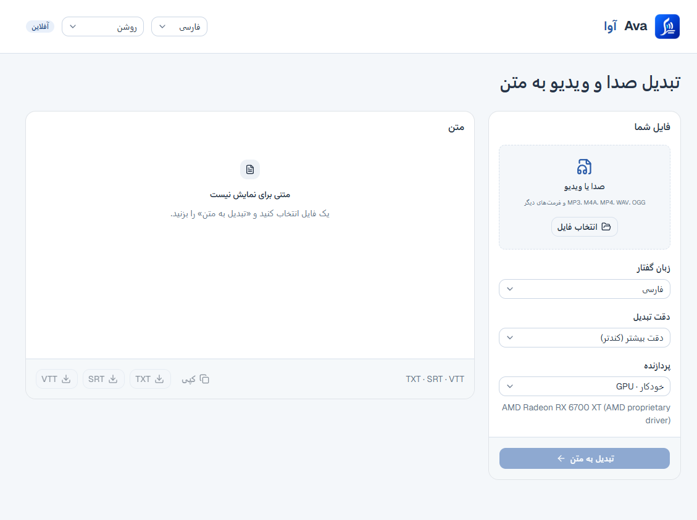
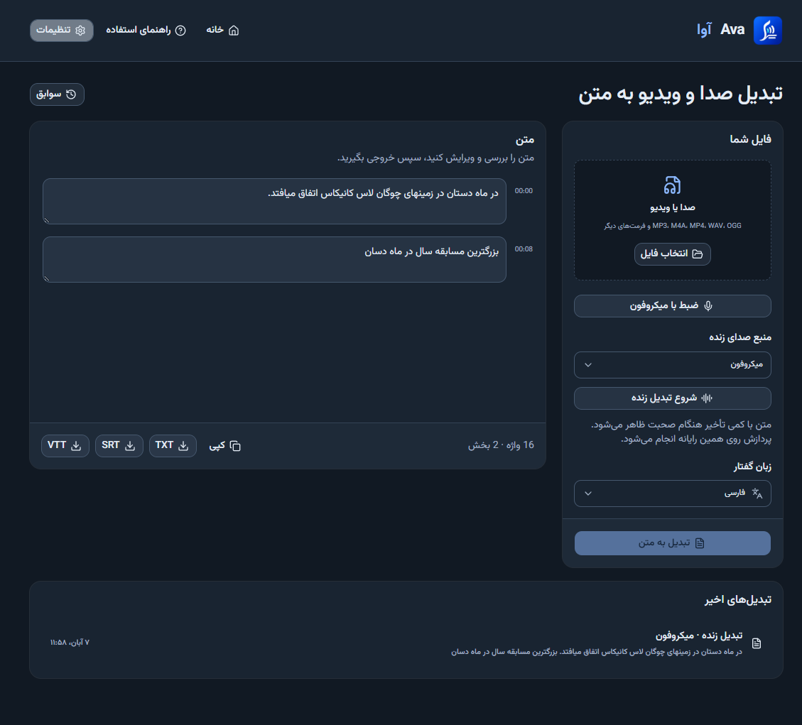
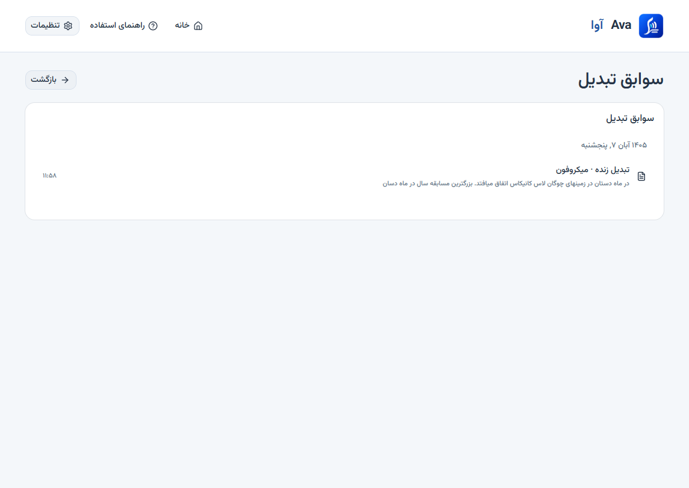

# Ava · آوا

A Windows and Linux app that turns Persian audio and video into editable text. Transcription runs on your computer, including when you are offline. There is no account or paid API.

## Install

1. Open the [latest release](https://github.com/aliabedi1/persian-transcriber/releases/latest).
2. Download **Ava-Setup-1.3.0-x64.exe** and run it.
3. Open **Ava** from the desktop or Start menu.

Linux x64 (Ubuntu 24.04+ or compatible, with an AVX2-capable CPU):

- **Ava-1.3.0-linux-amd64.deb**: open with your software installer, or run `sudo apt install ./Ava-1.3.0-linux-amd64.deb`. Ava appears in the applications menu.
- **Ava-1.3.0-linux-x86_64.AppImage**: portable. Run `chmod +x Ava-1.3.0-linux-x86_64.AppImage`, then open it. Without FUSE, launch with `--appimage-extract-and-run`.

Linux GPU mode requires your GPU vendor's Vulkan driver. Auto falls back to CPU if GPU startup fails. Release checks run on CPU; Linux GPU hardware has not been tested.

Installers include the native tools but no transcription models. Installation, setup, and first launch do not download models. Open **Settings → Models** while online, explicitly download a model, then select **Use model**. No Python, Node.js, account, or API key is needed for installed apps. After download, transcription works offline. Allow about 549 MB for Turbo Q5 or 1,032 MB for Large v3 Q5, including the shared speech detector.

The installer is unsigned, so Windows may show a publisher warning. Uninstall through **Windows Settings → Apps**.

## Use

1. Download and select a model in **تنظیمات ← مدل‌ها / Settings → Models**, then click **انتخاب فایل / Choose file** and select an audio or video file.
2. Set **زبان گفتار / Spoken language** to the language in the recording. Persian is selected by default.
3. Choose a downloaded model in settings and a processor, or keep your saved selection. Model changes apply to the next job; an active transcription keeps its original model.
4. Click **تبدیل به متن / Transcribe recording**.
5. Review and edit the passages. Use **Copy**, **TXT**, **SRT**, or **VTT** to save the result.

Completed transcriptions are saved automatically as TXT, SRT, and VTT under **Documents/Ava**, in date folders. Use **Change folder** to choose another location. Windows, Linux, and macOS folder locations come from the OS. Changing the folder affects future jobs; existing files stay where they were saved.

The main page lists the latest five transcriptions. Use **All history / سوابق** to browse entries grouped by date and reopen them without the original recording. Edits can be saved with **Save changes / ذخیرهٔ تغییرات**. History and settings are stored in a local SQLite database in the app data folder. If automatic file saving fails, the app keeps the history entry and offers a retry.

Common inputs include MP3, M4A, WAV, OGG, FLAC, MP4, MKV, MOV, and WebM. Video files must contain an audio track.

| Setting | Options |
| --- | --- |
| Models | Download one or multiple models and select **Use model**. Large v3 Turbo Q5 is faster; Large v3 Q5 is larger and slower and does not always give a better result. Downloads and selection persist across restarts. |
| Processor | **Auto** uses a detected Vulkan GPU, with CPU fallback. Select **CPU** or **GPU** to choose manually. GPU mode needs a compatible driver. |
| Interface | **فارسی** uses RTL; **English** uses LTR. This is separate from the recording language. |
| Appearance | System (default), Light, and Dark are available in the header. System follows OS changes until you choose an override. |

## Screenshots

Persian interface in light mode:



A transcript in dark mode, with editing and export controls:



History groups saved transcriptions by date:



Screenshots show version 1.2.0. The example audio is a public Persian sample from [Google FLEURS](https://huggingface.co/datasets/google/fleurs), not a user's recording.

## What to expect

- Speech detection skips non-speech sections before transcription.
- Recordings are processed locally and are not uploaded. Temporary audio is removed after completion or cancellation; a crash can leave temporary files.
- Automatic transcripts can contain wrong words, especially names and technical terms. Review them before use.
- Ava does not identify speakers, translate recordings, or record a live microphone.

See [VALIDATION.md](VALIDATION.md) for tests and known accuracy limits.

## Run from source

Requires Windows x64, Node.js, and FFmpeg. Internet is needed for initial dependencies and for model downloads explicitly started in settings.

```powershell
git clone https://github.com/aliabedi1/persian-transcriber.git
cd persian-transcriber
# Install FFmpeg if needed, then reopen PowerShell:
winget install --id Gyan.FFmpeg.Shared -e
./setup.ps1
npm start
```

```powershell
npm run build          # Build the interface
npm test               # Engine unit tests
npm run test:models    # Model store tests + real downloads and Windows/Linux desktop inference
npm run test:desktop   # Desktop checks
npm run test:timing    # Timer checks
npm run test:history   # SQLite storage and history checks
npm run dist:win       # Build the Windows installer
```

The app uses Electron, React, and shadcn/ui. Setup downloads native binaries only. Model downloads are managed in settings and stored under the OS app data folder (on Windows, `%APPDATA%/ava-persian-transcriber/models`). Validated downloads remain available offline; a missing or invalid file disables that model. Retry failed/interrupted downloads in settings: verified files are reused, incomplete files restart from the beginning. Existing development `models/` files and models in older installers are not used automatically. See [the developer catalog guide](docs/MODELS.md) to add models and sources.

## Credits and license

Ava's code is [MIT licensed](LICENSE). It uses [Whisper.cpp](https://github.com/ggml-org/whisper.cpp), [Whisper models](https://huggingface.co/ggerganov/whisper.cpp), [Silero VAD](https://github.com/snakers4/silero-vad), [FFmpeg](https://ffmpeg.org/), and a [community Windows Vulkan build](https://github.com/nyancodex/whisper-server-vulkan-windows). Third-party software retains its own license; notices are in [third-party](third-party/).

### Linux development

Requires Ubuntu 24.04+ x64 and Node.js 24+:

```bash
sudo apt install build-essential cmake ffmpeg libvulkan-dev glslc spirv-headers glslang-tools libgtk-3-0 libnss3 libasound2t64 libgbm1
npm ci
bash scripts/setup-linux.sh
npm run build
npm start
npm run dist:linux
```

Setup compiles CPU and Vulkan engines from pinned Whisper.cpp source. Models are optional downloads in settings; each file is checked against the catalog size and SHA-256 before use. macOS and Linux ARM packages are not provided.
